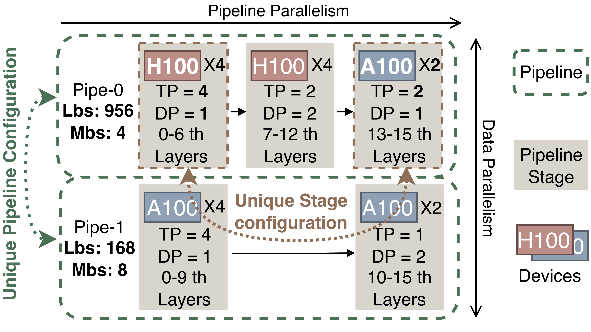

# ETH: Data-Balanced Pipeline Parallelism for Training Large Models on Heterogeneous Clusters （NSDI 2027）

ETH is a system for profiling, searching, and training with Heterogeneous Pipeline Parallelism (HPP) configurations.

## Table of Contents

- [Key Features](#key-features)
- [Environment](#environment)
- [Profile](#profile)
- [Search](#search)
- [Train](#train)
- [Outputs](#outputs)
- [Other](#other)

## Key Features

- **Scalable HPP Configuration Search:** Explores a large configuration space spanning pipeline layouts, stage
  boundaries, device placement, tensor parallelism, data parallelism, and micro-batch sizes across heterogeneous
  clusters.
- **Low-Overhead Search:** Uses hierarchical device grouping, workload balancing, configuration caching, early
  pruning, searching order optimization and dynamic programming to find efficient HPP configurations quickly.
- **Efficient HPP Execution:** Executes heterogeneous pipeline configurations with stage-specific parallelism,
  pipeline scheduling, and Block-wise All-Reduce to reduce gradient synchronization overhead.


<p align="center">
  <picture>
    
  </picture>
</p>


## Environment

The supported release environment is Ubuntu 22.04, Python 3.10, CUDA 12.4,
PyTorch 2.6.0 with cu124, and the pinned Apex submodule.

Initialize Apex before building or running:

```bash
git submodule update --init --recursive
```

Build and enter the development container:

```bash
docker build -t eth:cuda12.4 .
docker run --rm -it --gpus all --ipc host --network host \
  -v "$PWD":/workspace/eth \
  -w /workspace/eth \
  eth:cuda12.4
```

For a manual installation:

```bash
python3.10 -m pip install \
  torch==2.6.0 --index-url https://download.pytorch.org/whl/cu124
python3.10 -m pip install -r requirements.txt -r requirements-dev.txt

cd external/apex
PYTHONPATH="../../eth/runtime:../..${PYTHONPATH:+:$PYTHONPATH}" \
  python3.10 -m pip install --no-build-isolation -v .
cd ../..
```

The pinned Apex revision is installed as a Python package. ETH uses its
PyTorch optimizer and multi-tensor fallbacks when the revision's legacy native
extensions are unavailable under the release toolchain.

## Profile

Run the profiler on every participating node with the same output directory and
rendezvous values. This single-node example covers TP sizes 1, 2, and 4:

```bash
bash scripts/profile_gpt.sh \
  --model gpt \
  --model-size 1_3B \
  --hardware example-gpu \
  --tp-sizes 1,2,4 \
  --num-nodes 1 \
  --gpus-per-node 4 \
  --node-rank 0 \
  --master-addr 127.0.0.1 \
  --master-port 29500 \
  --output results/profiles/example-gpu-1_3B
```

The output contains operation, collective, and P2P records plus
`profile_metadata.json`. `--dry-run` writes a `planned` metadata record and
`profile_plan.txt` without collecting measurements. Planned output cannot be
used by search. Multi-node operation profiling also requires
`--reference-profile` for task distribution.

## Search

Create a node description for the profiled hardware:

```json
{
  "node_info": {
    "0": {"GPU": "example-gpu", "GPU_NUM": 4, "NODE_NUM": 1}
  },
  "device_info": {
    "example-gpu": {
      "memory": 64000,
      "intra_bandwidth": 20,
      "TFLOPS": 100
    }
  }
}
```

Pass that file and the completed profile explicitly:

```bash
bash scripts/search_gpt.sh \
  --profile-dir results/profiles/example-gpu-1_3B \
  --model-size 1_3B \
  --search-budget 10 \
  --global-batch-size 1024 \
  --node-description examples/configs/node_example_gpu.json \
  --output results/search/example-gpu-1_3B
```

Search validates profile schema, completion status, model, hardware, TP
coverage, node capacity, and every required measurement record before invoking
the algorithm. The published result is
`results/search/example-gpu-1_3B/gpt_config.json`, normalized to the GPT HPP
runtime contract. `--dry-run` validates inputs and writes `search_plan.txt`.

## Train

Validate a generated config on CPU before CUDA setup:

```bash
bash scripts/train_gpt.sh \
  --config results/search/example-gpu-1_3B/gpt_config.json \
  --gpus-per-node 4 \
  --num-nodes 1 \
  --node-rank 0 \
  --master-addr 127.0.0.1 \
  --master-port 29500 \
  --grad-sync-mode block \
  --validate-only
```

Launch single-node training with Block-wise synchronization:

```bash
bash scripts/train_gpt.sh \
  --config results/search/example-gpu-1_3B/gpt_config.json \
  --gpus-per-node 4 \
  --num-nodes 1 \
  --node-rank 0 \
  --master-addr 127.0.0.1 \
  --master-port 29500 \
  --precision fp16 \
  --grad-sync-mode block \
  --grad-sync-bucket-size-mb 32 \
  --log-dir results/train/example-gpu-1_3B \
  --train-iters 3
```

Use `--grad-sync-mode tensor` for the tensor-wise reference. FP32 omits a
precision flag internally; FP16 and BF16 map to their corresponding runtime
flags. Cluster-specific NCCL settings remain caller-provided environment
variables.

For two nodes with four GPUs each, first search with a node description whose
`NODE_NUM` is 2 so the generated config has world size 8. Run the same command
on both nodes, changing only `NODE_RANK`:

```bash
NODE_RANK=0  # use 1 on the second node
bash scripts/train_gpt.sh \
  --config results/search/example-gpu-2node/gpt_config.json \
  --gpus-per-node 4 \
  --num-nodes 2 \
  --node-rank "$NODE_RANK" \
  --master-addr training-master.example \
  --master-port 29500 \
  --precision fp16 \
  --grad-sync-mode block \
  --log-dir results/train/example-gpu-2node \
  --train-iters 3
```

Tracked neutral configs under `examples/configs/` cover a canonical 4-rank
topology, a heterogeneous 6-rank topology, and the stage-level brief format.
They are validation examples, not hardware measurements or performance claims.

## Outputs

- Profile records and metadata: the `--output` passed to
  `scripts/profile_gpt.sh`.
- Search config: `<search-output>/gpt_config.json`.
- Search logs and intermediate configs: `<search-output>/logs/` and
  `<search-output>/configs/`.
- Training logs and CSV summaries: the `--log-dir` passed to
  `scripts/train_gpt.sh`.


## Other

This repository is derived from
[Microsoft SuperScaler](https://github.com/microsoft/SuperScaler) and retains
runtime code adapted from NVIDIA Megatron-LM. See `NOTICE` for source revisions,
license provenance, and other retained upstream components.
